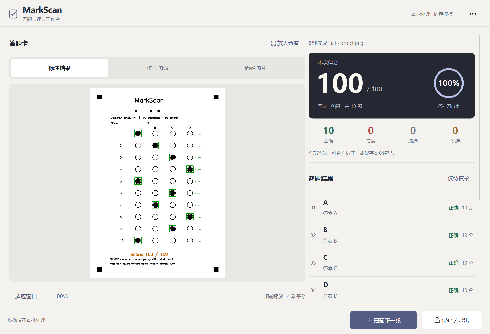
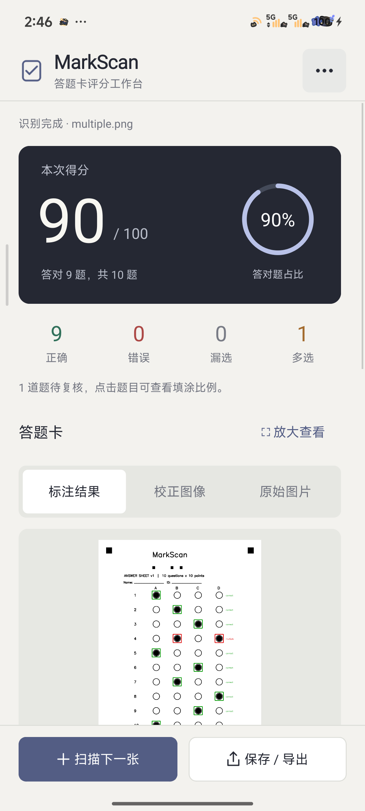

# MarkScan

基于 **Qt + C++17 + OpenCV** 的 Windows / Android 答题卡识别与自动评分工具。

当前版本 **1.1.0**。面向小型测验、教学演示与计算机视觉工程实践，导入固定模板图片即可查看成绩、逐题判定与标注。图像在本机处理，无需上传服务器。

## 主要功能与平台

- PNG/JPEG 导入、四角定位、透视校正、填涂识别与自动评分。
- 10 道 A–D 单选题，每题 10 分；区分正确、错误、漏选、多选。
- 原图 / 校正 / 标注切换，大图预览、缩放、仅待复核筛选与逐题填涂比例。
- JSON 标准答案配置；保存 result.json、corrected.png、annotated.png，或单独导出 PNG。
- 六个内置演示场景，Qt Concurrent 工作线程执行识别。

| 平台 | 支持与验证 |
| --- | --- |
| Windows x64 | Qt Widgets 分栏界面；Release 构建、六场景评分保存与 UI 自动检查已有记录 |
| Android ARM64 | 共用 Qt Widgets 界面及 JNI 存储适配；小米 13、Android 16、4 KiB 页已真机验证 |

Android 通过系统图片/文件选择器导入，可先用系统相机拍照；目前没有应用内相机入口。完整结果存于应用私有目录，卸载会移除；PNG 可导出至公共位置。

## 实际截图

以下为 1.1 真实运行画面，使用合成答题卡，姓名与学号栏为空。百分比表示答对题占比。





## 技术栈与系统架构

| 模块 | 技术与职责 |
| --- | --- |
| UI | Qt Widgets、Qt Concurrent；MainWindow 调度导入与导出，Theme / ScoreCard / ImageCanvas 显示结果 |
| 核心 | C++17、OpenCV 4.6；markscan_core 独立于 Qt，负责定位、识别与评分 |
| 适配 | Windows 文件系统；Android JNI / ContentResolver 读写系统 URI |
| 工程 | CMake ≥3.21、Ninja、MSVC 2022 / Android NDK Clang |
| 测试 | C++ 合成图像与断言、CTest、UI --smoke 入口 |

```text
系统选图 / PNG / JPEG
        ↓
Qt UI → 图像读取 → Qt Concurrent 工作线程
                         ↓
               markscan_core / OpenCV
                         ↓
              Result / 逐题比例 / 标注图
                         ↓
                  UI 复核 → JSON / PNG
```

### OpenCV 识别流程

1. 检查输入，将大图缩至最长边不超过 2400 像素。
2. 灰度化、3×3 高斯模糊、51×51 自适应反向二值化（C=12）。
3. 根据轮廓面积、四边形近似、凸性与矩形占有率筛选四角候选。
4. 枚举四角组合与四种方向，透视校正至 1240×1754。
5. 验证方向码 10110 与选项印刷圈，拒绝不完整或错误模板。
6. 统计各选项半径 17 像素圆盘的黑色比例，默认 ≥0.40 判为填涂。
7. 恰好单选且符合标准答案得 10 分，其余 0 分，生成标注图。

无 OCR 或深度学习依赖。详见 [模板坐标](docs/template-coordinates.md)。

## 项目目录

```text
core/                 公共 C++ 识别与评分
desktop/              两端共用 Qt UI 与入口
android/              Manifest、JNI 存储适配
config/answers.json   示例答案与阈值
templates/            空白 PNG、可打印 A4 PDF
tests/                自动化测试与合成输入图片
tools/                SheetFactory、PDF 生成工具
scripts/              可配置路径的构建脚本
docs/screenshots/     已审查真实截图
docs/validation/      历史验证与发布审查
CMakeLists.txt        双平台构建配置
```

## Windows 构建与运行

已验证 Qt **6.10.2 MSVC x64**、OpenCV **4.6.0**、Visual Studio 2022。安装 VS C++ 桌面开发工具、CMake、Ninja，以及匹配 x64 ABI 的 Qt Widgets / Concurrent 和 OpenCV 开发包。仓库不附带 SDK。

Private 仓库克隆需要先通过自己的 GitHub 账号认证：

```powershell
git clone https://github.com/Fairy-fly/MarkScan.git
cd MarkScan
```

打开 **Developer PowerShell for VS 2022**。以下是占位路径，请替换为实际安装位置：

```powershell
$env:OpenCV_DIR = 'C:/deps/opencv/build/x64/vc15/lib'
$env:CMAKE_PREFIX_PATH = 'C:/Qt/6.10.2/msvc2022_64'
$env:PATH = "C:/Qt/6.10.2/msvc2022_64/bin;C:/deps/opencv/build/x64/vc15/bin;" + $env:PATH
.\scripts\build-windows.cmd
ctest --test-dir build-windows --output-on-failure
.\build-windows\MarkScan.exe
```

脚本使用 PATH 中的 CMake、Ninja 和已初始化的 MSVC。也可用 Qt Creator 打开 CMakeLists.txt，选择 MSVC x64 Kit 并设置 OpenCV_DIR。运行时须能找到 Qt / OpenCV DLL。

仅构建核心测试，无需 Qt：

```powershell
cmake -S . -B build-core -G Ninja -DCMAKE_BUILD_TYPE=Release -DMARKSCAN_BUILD_UI=OFF
cmake --build build-core
ctest --test-dir build-core --output-on-failure
```

测试会重新生成 templates/blank.png、tests/images 下的样例和被忽略的 tests/results 输出。UI 构建还提供 markscan_pdf.exe 生成模板 PDF。`MarkScan.exe --smoke .` 检查六场景，输出至本地忽略的 docs/upgrade；加上 `--mobile-preview --narrow` 可检查窄屏布局，不能替代真机测试。

Windows 便携分发需用 windeployqt 部署 Qt 插件与动态库，另带 OpenCV DLL 及相应许可；目标电脑可能需要 VC++ 2022 运行库。

## Android 构建与部署

已验证：Qt **6.5.3 android_arm64_v8a** 及同版本桌面 host Qt、OpenCV Android SDK **4.6.0**、NDK **25.1.8937393**、SDK **33** / build-tools **33.0.2**、JDK **17.0.5**、Gradle **8.0**、AGP **7.4.1**。

准备这些依赖，将 CMake、Ninja 加入 PATH。以下路径均为占位示例：

```powershell
.\scripts\build-android.ps1 `
  -QtAndroid 'C:/Qt/6.5.3/android_arm64_v8a' `
  -QtHost 'C:/Qt/6.5.3/mingw_64' `
  -OpenCVDir 'C:/deps/OpenCV-android-sdk/sdk/native/jni' `
  -SdkRoot 'C:/Android/Sdk' `
  -NdkRoot 'C:/Android/Sdk/ndk/25.1.8937393' `
  -JdkRoot 'C:/Java/jdk-17'
```

首次 Gradle 构建需要联网下载依赖，不包含旧机器的离线缓存。OpenCV 使用 java CMake 组件与相邻 libs/arm64-v8a/libopencv_java4.so，其提供原生 C++ API。当前 CMake 固定 ARM64、最低 API 23、target API 33；其他设备兼容性未全面验证。

输出 artifacts/MarkScan-debug-arm64.apk，Debug 签名、包名 org.markscan.app、versionName 1.1.0、versionCode 2。开启设备 USB 调试后：

```powershell
adb install -r artifacts/MarkScan-debug-arm64.apk
adb shell am start -n org.markscan.app/org.qtproject.qt.android.bindings.QtActivity
```

也可通过 Qt Creator Android ARM64 Kit 部署。不同签名的旧安装可能产生冲突；卸载会删除私有结果。正式分发需另行配置 Release 签名，签名文件与密码不得提交。

## 使用模板

打印 [A4 PDF](templates/MarkScan-A4.pdf) 时使用纵向、100% 实际大小，保留四角；每题充分填满一个选项。默认答案 A B C D A C B D C A，配置结构见 [answers.json](config/answers.json)。从“更多 → 体验样例”快速试用，或通过“更多 → 标准答案”载入配置。

## 测试与验证

已核对 2026-10-25 原始记录；本次整理检查结果见 [发布审查](docs/validation/publication-audit.json)。

| 检查 | 结果与边界 |
| --- | --- |
| 核心 | **14/14**，含 11 个图像场景及换答案、空输入、非法配置 |
| 合成有效卡 | 8 张、**80/80 题选项匹配**，仅代表此固定数据集 |
| 拒识 | 无卡、缺定位点、仅四方块三个场景均拒识 |
| Windows 1.1 | 六场景、异步导入、筛选、预览缩放、非法文件和保存已有记录 |
| Android 1.1 | 小米 13 真机六样例、系统选图、保存及 PNG 导出已验证 |
| 双端一致 | 同一透视卡总分、逐题判定、40 个填涂比例一致；导出 PNG 与保存标注像素一致 |
| 真实纸卡照片 | **尚未验证准确率**，合成透视图不能替代实拍 |

[历史验证记录](docs/validation/) 已移除工作站路径与源文件 URI。截图及历史 UI 记录对应隐私清理前的 1.1。本仓库清理“关于”中的个人信息并整理构建入口，未改变识别算法与评分规则；本次没有重新执行 Android 真机验证。

## 版本关系与发布范围

stable-formal-1.0 是本地旧交付快照；product-1.1 是后续 UI / 交互重构版本。当前源码来自 1.1，核心及默认答案与 1.0 一致。这些是本地目录，不是 Git 分支或 GitHub Release。

课程报告、提交包、旧二进制、录屏与完整本机日志不纳入仓库。详见 [发布范围](docs/PUBLISHING.md)。

## 限制与未来规划

- 仅支持 MarkScan v1 固定模板，不支持通用答题卡、手写 OCR、缺标记和严重遮挡。
- 浅涂、擦除残留、反光、强阴影可能导致固定阈值失效，边界填写需人工复核。
- 图片读取和解码仍在 UI 线程，未完成性能基准与长期稳定性测试。
- Android 双指缩放、Windows 实际滚轮/拖动及原生对话框鼠标流程尚未实操验证；16 KiB 页和其他机型未验证。
- 后续优先采集匿名真实纸卡照片评估错误类型，再考虑阈值鲁棒性、多机型适配、异步解码与自动化构建。

## 许可

第三方组件见 [THIRD_PARTY.md](THIRD_PARTY.md)。当前未选择项目开源许可证，展示源码不自动授予开源使用许可；公开前由作者决定许可证及分发范围。
